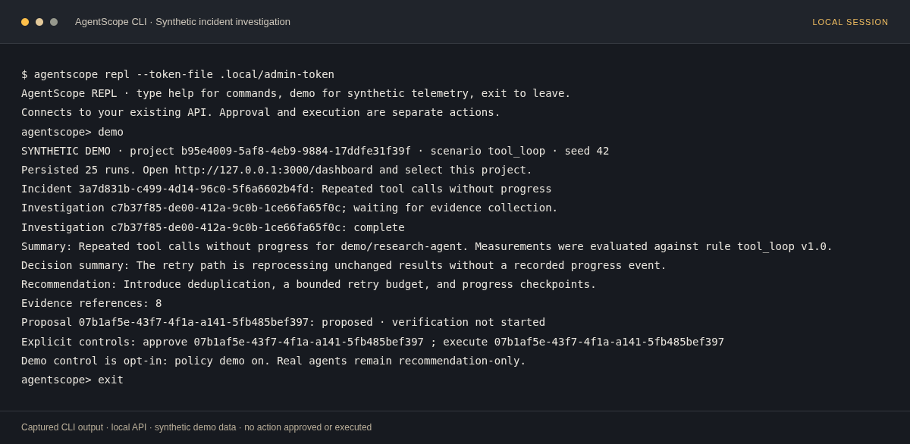

# AgentScope

**Understand your agents, from execution to recovery.**

AgentScope is a self-hosted observability workspace for AI agents. It brings together execution traces, tool calls, model usage, incident detection, and evidence-grounded investigations so you can understand what happened and decide what to do next.

The local workflow runs without a model API key. Start the server, connect the Python SDK or interactive CLI, and inspect the same persisted records in the dashboard.

[Getting started](#getting-started) · [CLI guide](docs/cli.md) · [API reference](docs/api.md) · [Container guide](docs/local-containers.md) · [Development](#development)

## What AgentScope does

| Capability | How it helps |
| --- | --- |
| Execution visibility | Inspect nested agent, tool, and LLM spans, latency, failures, observed token usage, and estimated cost for supported models. |
| Incident detection | Identify repeated tool calls, token-budget overruns, tool failure storms, stalled executions, and unexpected workflow steps. |
| Evidence-grounded investigation | Review persisted findings, competing hypotheses, recommendations, and references to the spans behind them. |
| Controlled demo intervention | Approve a proposal, execute it separately, and verify recovery against recorded follow-up telemetry. |
| Project-scoped telemetry | Create and revoke ingestion API keys, separate live runs from synthetic demos, and configure detectors and retention. |
| Multiple interfaces | Use the Next.js dashboard, interactive Python CLI, Python SDK, or authenticated REST and OTLP ingestion APIs. |

**Real agents remain recommendation-only.** Executable remediation is limited to an explicitly enabled, isolated synthetic demo adapter. A successful action response alone does not establish recovery.

## Getting started

### Prerequisites

- Python **3.12+**
- Node.js **24.x** and npm, matching the CI toolchain
- [uv](https://docs.astral.sh/uv/getting-started/installation/)
- Git

Docker, PostgreSQL, Redis, and external model credentials are not required for native development.

### Run the local workspace

```bash
git clone --branch main https://github.com/Devesh36/AgentScope.git
cd AgentScope
npm run setup
npm run dev
```

Setup creates a Python virtual environment, installs the API, SDK, and CLI, installs locked web dependencies, and runs database migrations. Keep the development process running while using the dashboard or CLI.

| Interface | Local address |
| --- | --- |
| Landing page | `http://localhost:3000` |
| Product documentation | `http://localhost:3000/docs` |
| Dashboard | `http://localhost:3000/dashboard` |
| API | `http://127.0.0.1:8000` |
| Interactive API schema | `http://127.0.0.1:8000/docs` |

A new workspace starts empty. In the dashboard, create a project and an API key in **Settings**, then instrument your agent. To explore first, use the explicitly labeled synthetic demo below.

### Connect the CLI

From the repository root, open another terminal:

```bash
.venv/bin/agentscope repl \
  --url http://127.0.0.1:8000 \
  --dashboard http://127.0.0.1:3000 \
  --token-file .local/admin-token
```

The CLI uses the server's admin token file. Project ingestion API keys are for the SDK and telemetry APIs; they do not replace this admin credential. Do not commit or share token files.

To install the CLI separately with uv:

```bash
uv tool install "git+https://github.com/Devesh36/AgentScope.git@main"
agentscope --version
agentscope repl --token-file /path/to/server/admin-token
```

The CLI connects to an existing server; installing it does not start the dashboard or database. Homebrew installation and connection options are covered in the [CLI guide](docs/cli.md).

### Explore a synthetic incident

In the REPL:

```text
help
status
demo
```

`demo` creates a dedicated project, records synthetic runs, detects a tool-loop incident, and waits for its investigation. It prints the recommendation, evidence count, and proposal ID. It does not approve or execute an action.



*Captured from a local CLI session against the running API. IDs are specific to that session; use the IDs printed by your own run.*

To practice the separate intervention steps, replace the placeholders with your proposal and investigation IDs:

```text
policy demo on
approve REMEDIATION_ID
execute REMEDIATION_ID
verify INVESTIGATION_ID
```

Verification observes persisted follow-up runs after a 15-second window. Select the demo project in the dashboard to inspect the same traces, incident, and investigation. See the [CLI guide](docs/cli.md) for other scenarios and command details.

## Instrument your Python agent

The setup script installs the local `agentscope-sdk`. Create a project ingestion key in **Settings → API keys** and supply it through your application's secret configuration as `AGENTSCOPE_API_KEY`.

```python
import os
from agentscope_sdk import AgentScope

with AgentScope(
    endpoint="http://127.0.0.1:8000",
    api_key=os.environ["AGENTSCOPE_API_KEY"],
    agent_name="calculator-agent",
) as scope:

    @scope.trace_tool
    def add(left, right):
        return left + right

    @scope.trace_agent
    def run():
        total = add(2, 3)
        scope.heartbeat("calculation complete")
        return total

    print(run())
```

The SDK registers the agent and exports telemetry on a bounded background queue. It supports synchronous and asynchronous decorators, nested spans, progress events, retry deduplication, and graceful shutdown. Arguments and results are represented by fingerprints rather than raw payloads. Record actual model usage when instrumenting LLM calls; unknown model pricing remains unavailable.

For a runnable async example, see [examples/demo-agent/main.py](examples/demo-agent/main.py). With the project API key configured securely, run `.venv/bin/python examples/demo-agent/main.py`.

## Architecture and configuration

AgentScope is a modular monolith: a **Next.js** dashboard proxies authenticated requests to a **FastAPI** API, while **SQLAlchemy** stores telemetry and a durable transactional outbox. The local worker processes detections and a bounded, deterministic **LangGraph** investigator.

Native mode uses SQLite with WAL and stores data and the generated admin token in ignored `.local/`. Run one API worker in local mode. PostgreSQL is supported through `DATABASE_URL` and Alembic migrations.

- Set `DASHBOARD_PASSWORD` before making the workspace available outside a trusted local environment. Use HTTPS and authenticated ingress for deployment.
- Keep the admin token, ingestion API keys, and `.local/` private. Project API keys are stored as digests and can be revoked.
- Optional OpenAI-compatible suggestions require a server-side provider key and an HTTPS destination allowlist. The deterministic investigator works independently, and model suggestions remain unverified.
- The optional [container stack](docs/local-containers.md) uses PostgreSQL, pinned images, mounted secrets, readiness checks, and loopback-only published ports.

The current release does not provide multi-user organization management, production RBAC, distributed worker coordination, or control adapters for real agents. External paid-provider behavior and production deployments require separate validation.

## Development

Use the existing repository scripts:

```bash
npm run test:api
npm run test:cli
npm run test:web
npm --prefix apps/web run typecheck
.venv/bin/ruff check apps/api packages/python-sdk packages/cli examples
.venv/bin/mypy apps/api/app --ignore-missing-imports --follow-untyped-imports
npm run build
```

With the local servers running, `npm --prefix apps/web run test:e2e` exercises the browser workflow. Browser tests create dedicated synthetic projects. Stop the web development server before a production build so the build does not replace its active output.

`npm run accept:containers` runs the isolated container, SDK, browser, CLI, restart-persistence, and graceful-shutdown checks. Read its [prerequisites and resource requirements](docs/local-containers.md) first. It retains its database volume and sanitized measurements; it does not prune Docker resources.

### Landing site and documentation

`apps/landing` is the independent, light-and-amber public site. It exports the homepage and `/docs` as static files and requires no API, database, or server credentials.

```bash
npm --prefix apps/landing ci
npm --prefix apps/landing run build
npm --prefix apps/landing run typecheck
npm --prefix apps/landing run verify
```

The homepage’s **Phase** section records dated development milestones and every source commit. Its build merges Git history with a curated snapshot, preserving older milestones in shallow or Git-free builds. See [the timeline maintenance guide](docs/development-phases.md) when making changes.

For Vercel, use **apps/landing** as the Root Directory and **main** as the production branch. See [the deployment guide](apps/landing/README.md). The dashboard remains in `apps/web`; it is a separate application.

## Documentation

- **Public `/docs` page:** product overview, local setup, CLI walkthrough, terminal screenshots, SDK integration, and troubleshooting.
- [CLI guide](docs/cli.md): installation, authentication, scenarios, and explicit intervention commands.
- [API reference](docs/api.md): endpoints, project authorization, normalized events, and OTLP ingestion.
- [Container guide](docs/local-containers.md): prerequisites, startup, restart, shutdown, and trust configuration.
- [Local validation records](docs/container-validation.md): measured behavior and remaining limitations.

For a reproducible bug report, include the source commit, runtime versions, steps to reproduce, and sanitized output. Exclude credentials, private telemetry, and `.local/` contents.
