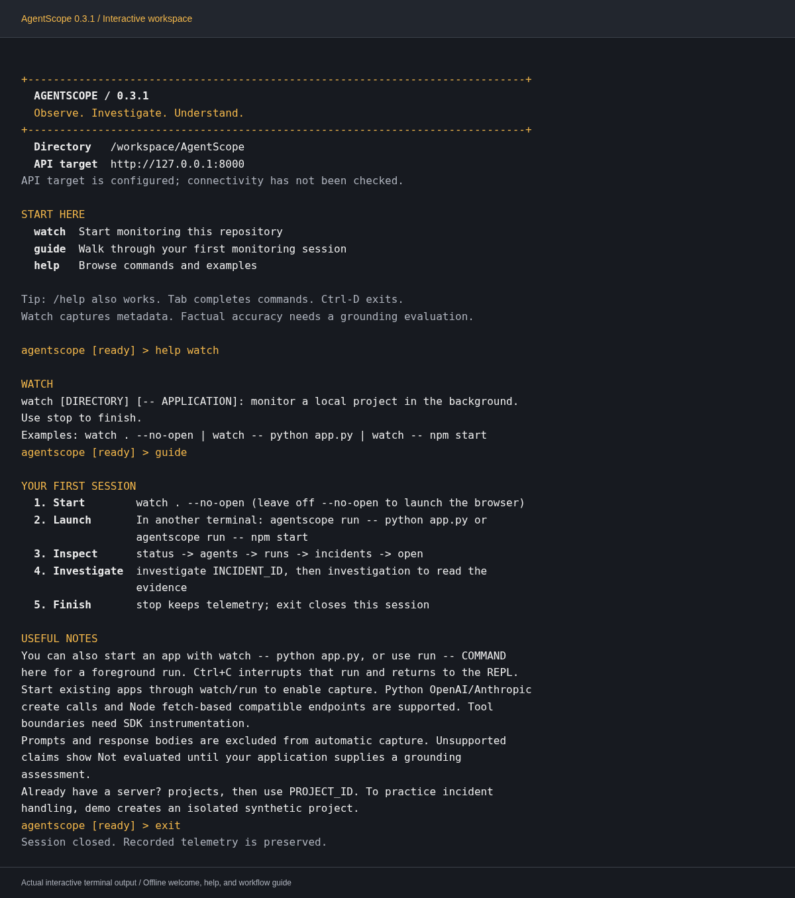

# Install and explore AgentScope

The CLI starts a local monitoring workspace with **watch**, or connects to an existing server with **repl**. The public landing page is `/`; the overview is `/dashboard`.

## Monitor your project

```bash
cd /path/to/your/project
agentscope watch -- python app.py
# Node.js:
agentscope watch -- npm start
```

The dashboard opens automatically with the correct project selected. The first run prepares the bundled API and Next.js dashboard; Node.js 24 with npm, uv, and Python 3.12+ are required on macOS/Linux. No project source files are modified.

For a watcher independent of your application, run `agentscope watch`, then `agentscope run -- YOUR_COMMAND` from a second terminal in the same directory. In the REPL, `watch` or `monitor .` starts background monitoring; `stop` ends it. Help and existing server commands remain available.

See [the watch guide](watch.md) for exact provider coverage, streams, storage, shutdown, and grounding evaluation support.

## Interactive workspace

The REPL opens with an amber welcome screen, your current directory, and the
configured API target. It checks connectivity when you request server data.
The prompt shows the selected project and whether this REPL owns a watch session.

```text
guide                   # Learn the monitoring workflow without connecting
/help                   # Browse commands grouped by task
help watch              # Read usage and examples for one command
watch . --no-open        # Start local monitoring and keep the REPL interactive
run -- python app.py     # Launch with capture; wait for exit (Ctrl+C returns here)
status                  # Read activity, usage, and watch health
agents                  # List registered agents
runs                    # Inspect recent executions
incidents               # Find incident IDs for investigate
open                    # Open this project's dashboard
stop                    # Stop local services and keep telemetry
exit                    # Close the REPL
```

Comments above explain each command; enter only the text before `#`.
For long-running apps, launch with `watch -- python app.py` or use
`agentscope run -- COMMAND` in another terminal, keeping the REPL available.
`run` always launches in the repository watched by this REPL, even if `use`
selects another project for inspection.

`status`, `projects`, `agents`, `runs`, and `incidents` accept `--json` for full
API data. `status --json` returns an object containing `endpoint`, `project_id`,
`projects`, and `metrics`; list commands preserve their API response shape.
Readable summaries distinguish unavailable cost and unassessed grounding from zero.
`runs` and `incidents` display the API's first page (up to 50 records).

Every command also supports a leading slash, such as `/status`. Tab completes
command names; Up/Down recall commands within the current session. `tips` aliases
`guide`, and `commands` aliases `help`. `clear` clears the visible interactive
terminal. Output wraps to the terminal width; pipes, `TERM=dumb`, and `NO_COLOR`
use plain text. Blank input never repeats a command.



*Actual interactive output from an offline local session. Terminal colors follow
your terminal's palette; this capture uses a dark background with amber accents.*

## uv

Requires [uv](https://docs.astral.sh/uv/) and Python 3.12+. uv can download a suitable
Python interpreter if necessary.

```bash
uv tool install "git+https://github.com/Devesh36/AgentScope.git@main"
agentscope --version
agentscope repl
# Supported alias matching the requested spelling:
Agenscope Repl
```

This installs `agentscope-cli` from this repository, not from PyPI. In a checkout,
use `uv tool install .`. For a reproducible snapshot, replace the branch after `@`
with the release tag `v0.3.1` or a full source commit. If uv reports its tool bin
directory is missing from PATH, follow its shell setup instructions. The Python SDK is supplied to applications launched through watch/run; it is also installable separately for manual integration.

## Homebrew

Requires [Homebrew](https://brew.sh/) on macOS or Linux. This custom tap uses the
AgentScope repository, not Homebrew core. The formula uses the v0.3.1 source tag; Python 3.12, Node.js 24, and uv are installed as dependencies.

```bash
brew tap Devesh36/agentscope https://github.com/Devesh36/AgentScope.git
brew install Devesh36/agentscope/agentscope
brew test Devesh36/agentscope/agentscope
agentscope repl
```

The tap follows the repository's default branch. The formula uses a versioned source tag; development changes may reach main before the next tagged release. Update with `brew update && brew upgrade Devesh36/agentscope/agentscope`.
The CLI includes local service sources. Service dependencies are prepared on first watch; credentials and databases are created locally.

## Connect

Start the existing server using `npm run setup && npm run dev`, or follow
[the container guide](local-containers.md). No paid LLM is needed for this demo.
Use the server's **admin** token file, not a project ingestion API key. Keep files
private. Tokens are never accepted as command-line arguments.

```bash
# Native development server, from the repository root:
agentscope repl --url http://127.0.0.1:8000 \
  --dashboard http://127.0.0.1:3000 --token-file .local/admin-token

# Previously initialized container stack: substitute its actual path/ports.
agentscope repl --url http://127.0.0.1:18000 \
  --dashboard http://127.0.0.1:13000 \
  --token-file .local/container-acceptance/STACK_NAME/secrets/admin-token
```

Alternatively set `AGENTSCOPE_URL`, `AGENTSCOPE_DASHBOARD_URL`, and
`AGENTSCOPE_ADMIN_TOKEN_FILE`. `AGENTSCOPE_ADMIN_TOKEN` is also supported; a private
file avoids secrets in shell history. Without either token configuration, an
interactive terminal asks for a hidden token on first connection. Help works
offline. Noninteractive use requires a configured token. Remote servers require
HTTPS; authenticated redirects are rejected. Requests time out after ten seconds;
workflow polling is bounded to sixty seconds. Failed requests show clear errors
and never substitute canned results. Work remains persisted for later inspection.

## Demo: real APIs, synthetic executions

In the REPL:

```text
help
status
demo
```

`demo` creates a separate **REPL synthetic demo** project, selects it, and records
reproducible `tool_loop` telemetry with seed 42 and a healthy baseline. It waits
for detection and the persisted investigation, then prints evidence references,
the decision summary, recommendation, and proposal ID. It **never approves or
executes** an action or enables demo control automatically.

Open `/dashboard` (or type `open`) and select the printed project ID to inspect
the same records. The landing page also links to the authenticated simulation
lab. Practice intervention separately, replacing IDs with those printed:

```text
policy demo on
approve REMEDIATION_UUID
execute REMEDIATION_UUID
verify INVESTIGATION_UUID
investigation INVESTIGATION_UUID
```

Policy changes apply only to the selected project. The API restricts execution to
isolated synthetic adapters. Real agents remain recommendation-only. Verification
waits for the server's 15-second observation window and reads stored follow-up
measurements. Execution alone does not establish recovery. Duplicate protections
and audit records remain authoritative. Blank input never repeats a command.
Exiting preserves server data and background work.

Other scenarios: `demo token_budget`, `demo tool_failure`, `demo stalled`,
`demo unexpected_workflow`, and `demo healthy` (no incident expected). Each creates
its own project. `projects`, `use PROJECT_UUID`, `incidents`, and
`investigate INCIDENT_UUID` inspect existing workspaces. `exit` or Ctrl-D closes
the REPL. Evidence-grounded decision summaries are shown; hidden chain-of-thought
is never requested or displayed.

## Check locally

```bash
npm run test:cli
npm run test:api
npm --prefix apps/web run typecheck
npm run test:web
npm run build
# With an existing server and matching auth/URLs configured:
npm --prefix apps/web run test:e2e
```

CI additionally installs with uv and tests the Homebrew formula on macOS.
Hosted CI results are separate from local validation.

See [the measured local validation and remaining limitations](cli-validation.md).

The live CLI acceptance creates a dedicated synthetic project and explicitly exercises
approval, execution, delayed recovery and duplicate-action checks:

```bash
npm run accept:cli -- --url http://127.0.0.1:8000 \
  --token-file .local/admin-token --report .local/cli-report.json
```
